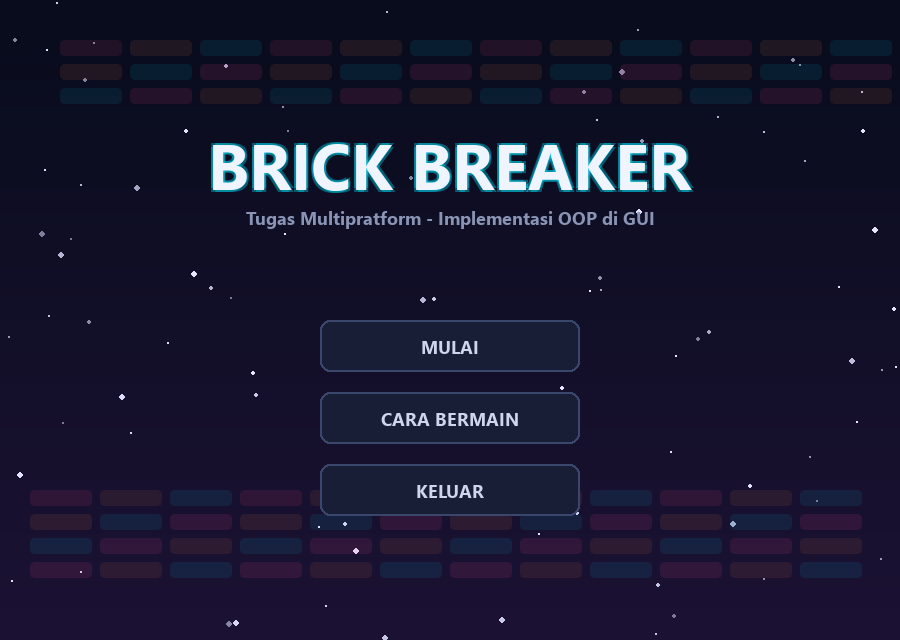
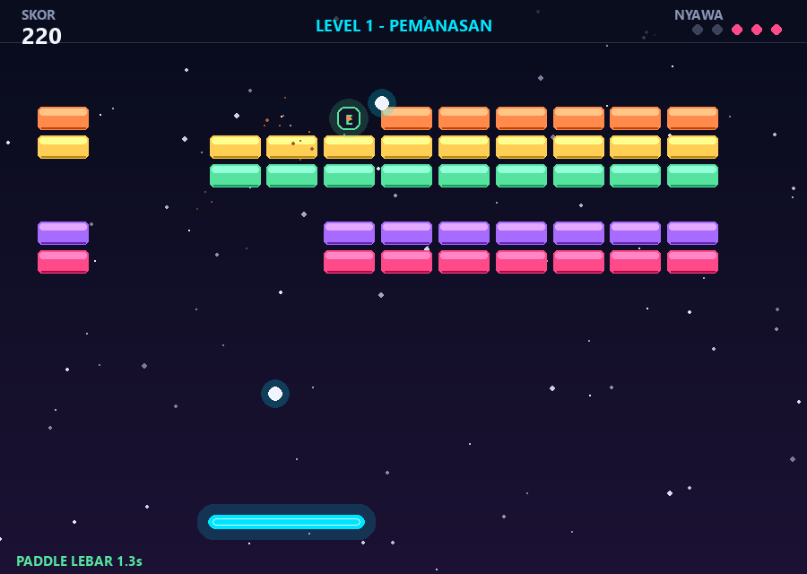
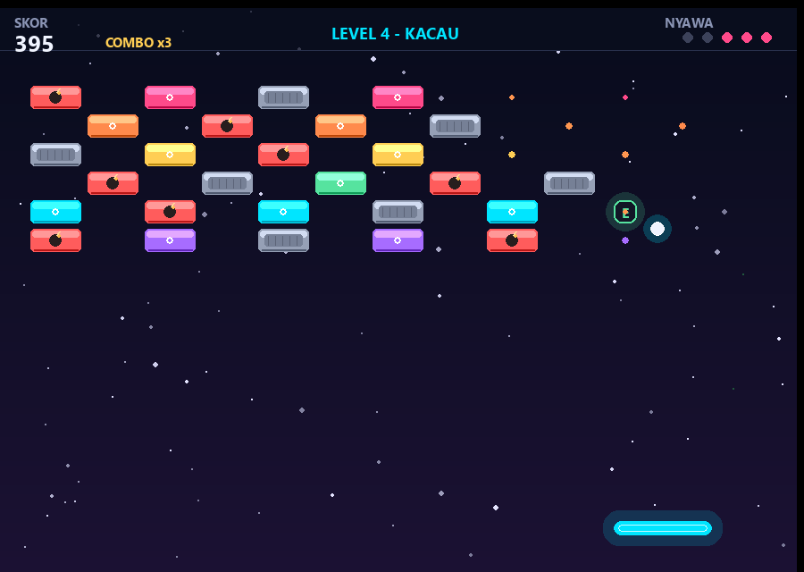
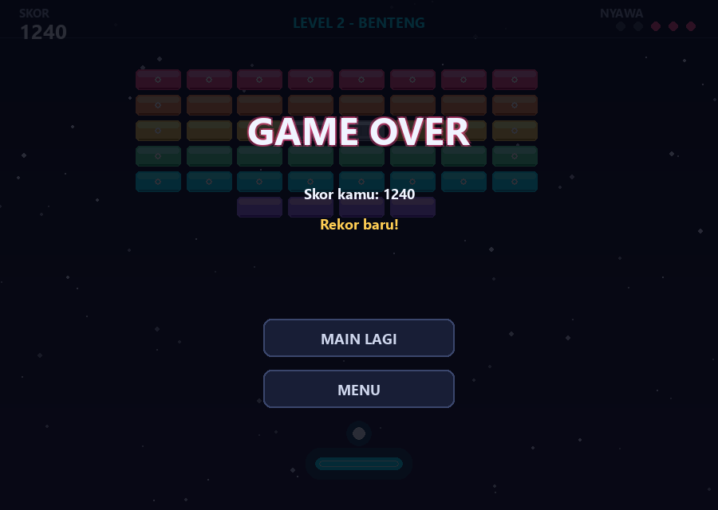

# Brick Breaker - ModifyGameBrickBreaker_010

Game brick breaker pakai Python + Pygame untuk tugas mata kuliah Multipratform (Implementasi OOP di GUI).

Program dasarnya ngikutin tutorial Brick Breaker di GeeksforGeeks, terus dimodifikasi lumayan banyak: ada menu, 4 level, jenis bata yang beda-beda, power up, efek partikel, sampai high score.

## Tampilan









## Fitur

- 4 level dengan layout dan kecepatan bola yang beda (Pemanasan, Benteng, Zigzag, Kacau).
- 4 jenis bata:
  - bata biasa, hancur sekali pukul
  - bata kuat, harus dipukul dua kali (ada garis retak kalau udah kena)
  - bata baja, nggak bisa hancur tapi tetap mantulin bola
  - bata bom, meledak dan ikut menghancurkan bata di sekitarnya
- 5 power up yang jatuh dari bata:
  - `E` paddle melebar
  - `M` nambah bola jadi tiga
  - `S` bola jadi lebih lambat
  - `+` nambah satu nyawa
  - `L` paddle laser, bisa nembak pakai SPACE
- Combo, makin banyak bata dihancurkan tanpa kena paddle, skor makin besar (sampai x5).
- High score disimpan di `highscore.json` dan muncul di menu.
- Efek partikel saat bata pecah, screen shake kalau bom meledak, latar bintang, dan sound effect yang dibuat langsung dari kode (tanpa file suara).
- Bisa main pakai keyboard atau mouse, ada menu pause dan layar game over.

## Kontrol

| Tombol | Fungsi |
| --- | --- |
| Panah kiri / kanan, A / D | geser paddle |
| Mouse | geser paddle langsung |
| SPACE | luncurkan bola / nembak laser |
| ESC atau P | pause |
| R | ulang level |
| M | kembali ke menu |

## Cara menjalankan

```bash
pip install -r requirements.txt
python main.py
```

Butuh Python 3.10 ke atas dan pygame 2.5+. Program dites di Python 3.13.5 + pygame 2.6.1.

## Struktur file

```
main.py         titik masuk program
game.py         class Game, ngatur state, input, collision, dan render
entities.py     GameObject, Paddle, Ball, Brick (dan turunannya), Bullet
powerups.py     PowerUp dan turunannya
levels.py       layout tiap level
effects.py      partikel, bintang latar, sound effect
ui.py           tombol, panel, dan tampilan menu
settings.py     ukuran layar, warna, font
```

## Bagian OOP-nya

- `GameObject` jadi kelas dasar buat semua objek yang punya posisi dan ukuran.
- `Brick` punya turunan `NormalBrick`, `StrongBrick`, `SteelBrick`, dan `BombBrick`. Masing-masing punya hp, poin, dan cara gambar sendiri.
- `PowerUp` punya turunan `ExpandPower`, `MultiBallPower`, `SlowPower`, `LifePower`, dan `LaserPower`. Tiap power up cukup meng-override method `apply()`.
- `Game` yang ngatur semua objek tadi, jadi objek-objeknya nggak saling manggil langsung.

## Referensi

- https://www.geeksforgeeks.org/python/brick-breaker-game-in-python-using-pygame/
